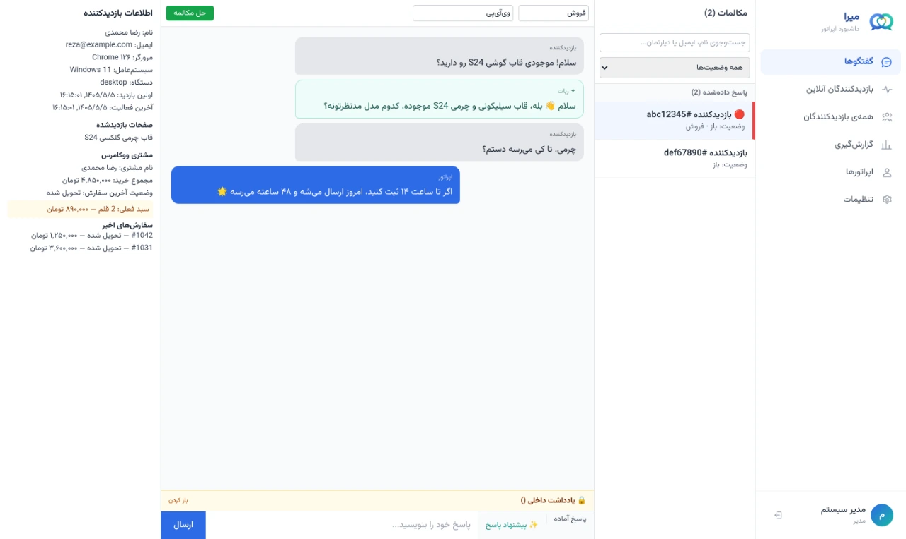
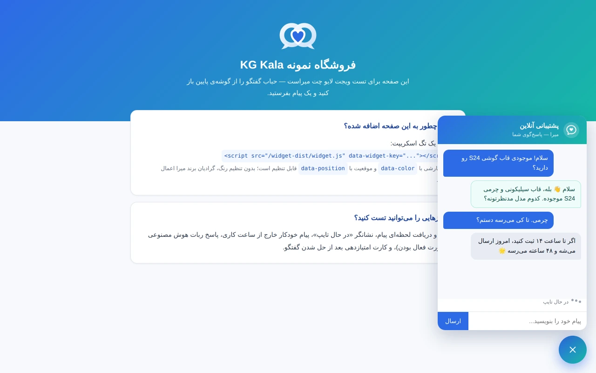
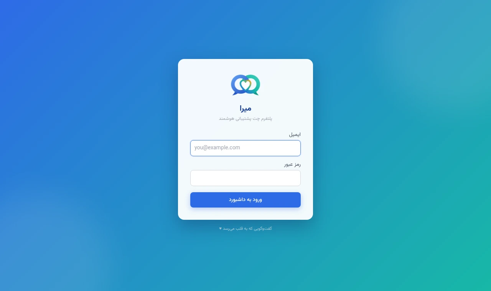
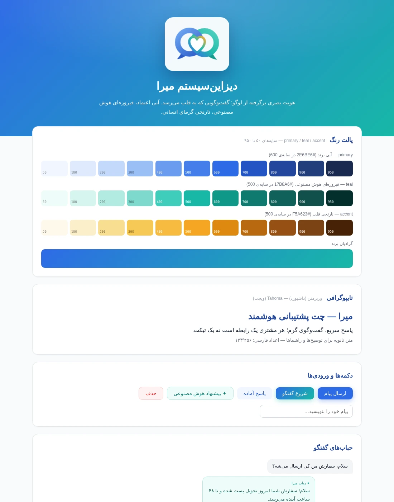

<div align="center">


# Mira (میرا)

**Self-hosted AI-powered live chat support for WordPress / WooCommerce**

_A conversation that reaches the heart ♥_

[](https://github.com/hami9/mira/actions/workflows/ci.yml)
[](LICENSE)
[](https://github.com/hami9/mira/releases)
[](CONTRIBUTING.md)

**English** · [فارسی](README.fa.md)

</div>

---

Mira is a complete, self-hosted alternative to hosted live-chat SaaS (Goftino, Crisp,
Tawk.to). You run it on your own server: the chat widget, the operator dashboard, the AI
bot with your own knowledge base, and the WooCommerce integration — **your data never
leaves your infrastructure.**

Built Persian-first (full RTL, Vazirmatn font, Persian UI), and multi-tenant from day one:
one installation serves many websites, each isolated by `siteId`.

## Screenshots

<div align="center">

|                    Operator dashboard                     |                          Chat widget                          |
| :-------------------------------------------------------: | :-----------------------------------------------------------: |
|  |         |
|                         **Login**                         |                       **Design system**                       |
|      |  |

</div>

### AI assistant controls

The widget now supports product cards, source links, suggested questions and live processing
states. Each store keeps its own name and sources. The AI settings panel controls sources, forbidden topics, retrieval relevance, model
and reply limits. Admins can also review visitor token usage, average usage, AvalAI credit,
actual charges and model cost estimates, with a link to the official payment page.
See [AI assistant setup and boundaries](docs/ai-assistant.md).

### Operator workspace

Switch between independently signed-in stores and identify background messages by store name.
Visitor cards and chat details show the current reported page and the conversation's entry
page, with a shortcut to start or reopen a chat. Settings now has separate AI, knowledge,
billing and system tabs. Import Markdown, manage source keywords and activation, and review
document usage. Store-specific guardrails have an on/off switch; tenant and source validation
remain enforced. See [the operator workspace guide](docs/operator-workspace.md).

Upload assistant and operator images up to 10 MiB, adjust the circular crop and save a small
avatar. The widget has a rounded composer and queue-driven AI animations with reduced-motion support.

Viewing a chat keeps AI running. Take over explicitly or send an operator reply; the chat badge
also lets the responsible operator return an open conversation to the enabled assistant.

## Features

- **Realtime chat** — Socket.io, typing indicators, unread badges, idempotent message
  delivery that survives network drops
- **AI that knows your shop** — RAG over your own knowledge base (pgvector), a reply
  Copilot for operators, auto-summaries, urgency escalation, and confidence-gated
  hand-off to a human. Works with any OpenAI-compatible endpoint (OpenAI, Gemini) or Anthropic
- **WooCommerce aware** — the operator sees the customer's cart, order history and total
  spend right next to the conversation; abandoned-cart trigger messages
- **Operations** — canned responses, CSAT ratings, departments/tags, business hours with
  out-of-hours auto-reply, internal notes, automation rules, outgoing webhooks (HMAC-signed)
- **Reporting** — conversation volume, first-response time, CSAT, per-operator performance,
  CSV export
- **Secure by default** — 2FA, role-based permissions read live from the database, strict
  CORS, CSP, rate limiting, and automatic HTTPS
- **One-command install** — a real Debian package, or prebuilt Docker images

## Quick install (Debian / Ubuntu)

```bash
sudo dpkg -i mira_*_all.deb || sudo apt -f install   # from Releases
sudo mira setup                                       # generates all secrets, asks for domains
sudo mira start
```

That's it — Caddy obtains and renews the TLS certificate automatically. The `mira` CLI also
handles `status`, `logs`, `backup`, `restore`, `update` and `doctor`.

Other distributions (AlmaLinux, Rocky, Fedora, …) use `package/install.sh`.
Full step-by-step guide: **[`package/INSTALL.md`](package/INSTALL.md)**

### Prebuilt Docker images

```
ghcr.io/hami9/mira-api
ghcr.io/hami9/mira-worker
ghcr.io/hami9/mira-dashboard
```

Choose "prebuilt image" during `mira setup` to skip building from source.

## Embedding the widget

```html
<script src="https://chat.example.com/widget-dist/widget.js" data-widget-key="YOUR_KEY"></script>
```

Optional attributes: `data-color`, `data-position`, `data-visitor-name`, `data-visitor-email`.
WordPress users can install the bundled plugin instead — it wires everything up, including
the WooCommerce customer panel.

## Architecture

```
Visitor (widget) ──Socket.io──┐
                              ├──► API (NestJS) ──► PostgreSQL + pgvector
Operator (dashboard) ─────────┘        │
                                       ├──► BullMQ (Redis) ──► Worker ──► AI provider
                                       └◄── Redis pub/sub ◄───────┘
```

| Layer               | Technology                                   |
| ------------------- | -------------------------------------------- |
| Backend + realtime  | Node.js 22.12+, NestJS, Socket.io            |
| Background jobs     | BullMQ on Redis                              |
| Database            | PostgreSQL 16 + pgvector                     |
| Dashboard           | React, Vite, TypeScript, Tailwind CSS        |
| Widget              | Plain TypeScript, no framework (~21 KB gzip) |
| WordPress plugin    | Plain PHP                                    |
| Reverse proxy / TLS | Caddy (automatic Let's Encrypt)              |

AI calls are **never** on the request path — they always run through the BullMQ queue, so
live chat never waits on a language model.

## Development

```bash
cp .env.example .env      # replace every *_PASSWORD / *_SECRET value
docker compose up -d --build
```

Dashboard on `http://localhost:5173`, widget demo on `http://localhost:3000/demo.html`.
Lint/format/build without Docker: `npm ci && npm run lint && npm run format:check && npm run build`.

See [`CONTRIBUTING.md`](CONTRIBUTING.md) for the project's non-negotiable rules (migrations,
tenant isolation, secrets handling) before opening a PR.

## Documentation

| Doc                                            | What's in it                                          |
| ---------------------------------------------- | ----------------------------------------------------- |
| [`README.fa.md`](README.fa.md)                 | Full Persian documentation — the deepest resource     |
| [`package/INSTALL.md`](package/INSTALL.md)     | Server installation, WordPress setup, troubleshooting |
| [`docs/brand/README.md`](docs/brand/README.md) | Brand guide and design system                         |
| [`AGENTS.md`](AGENTS.md)                       | Architecture decisions, real bugs fixed, known gaps   |
| [`CHANGELOG.md`](CHANGELOG.md)                 | Version history                                       |
| [`SECURITY.md`](SECURITY.md)                   | Reporting vulnerabilities                             |

## Status

Phases 0 through 7 of the roadmap are complete — see the release badge above for the current
version, and [`CHANGELOG.md`](CHANGELOG.md) for what changed. Honest caveats (untested
surfaces, known technical debt) are listed in [`AGENTS.md`](AGENTS.md) rather than hidden.
Unit tests, integration tests against real Postgres + Redis, and live browser E2E tests run
in CI. Control-panel deployment, public TLS and workload-specific resource sizing require
verification on the target host; local test results do not certify a production deployment.

## License

All shipped self-hosted features are free of Mira subscriptions, activation keys and paid
feature gates. Hosting and external AI usage have their own provider costs. Copyright:
**hami9 — [hami9.ir](https://hami9.ir)**. See [NOTICE](NOTICE).

For resource limits, running beside an existing website, one-address installation,
control-panel uploads without SSH, and ordinary shared-hosting connections, see
[Hosting Mira](package/HOSTING.md). Full backend hosting requires Node.js, PostgreSQL with
pgvector, Redis and a persistent worker; the WordPress plugin alone is not the backend.

Mira is licensed under the **[AGPL-3.0](LICENSE)**: you may use, modify and host it freely,
but if you offer a modified version to others — including as a network service — you must
publish your source under the same license.

**Exception:** the WordPress plugin (`wordpress-plugin/mira`) is **GPLv2 or later**, as the
WordPress ecosystem requires.
